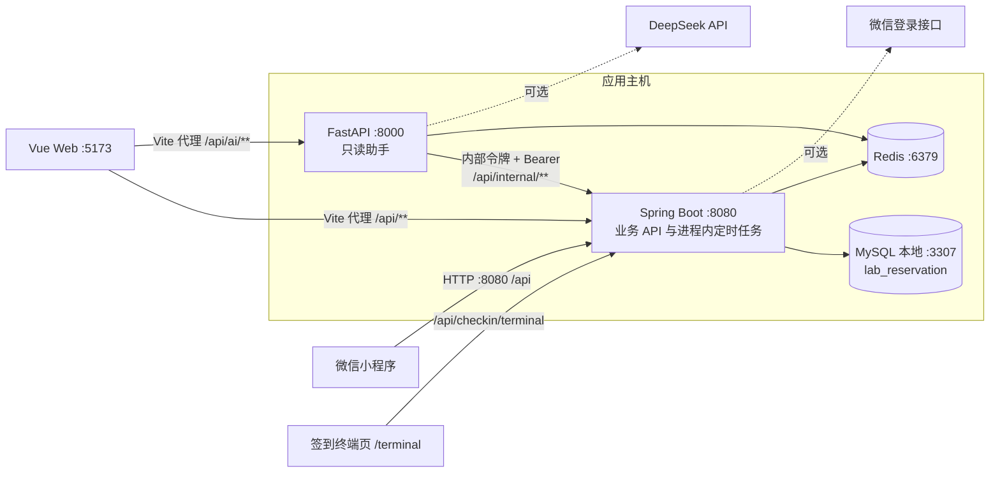
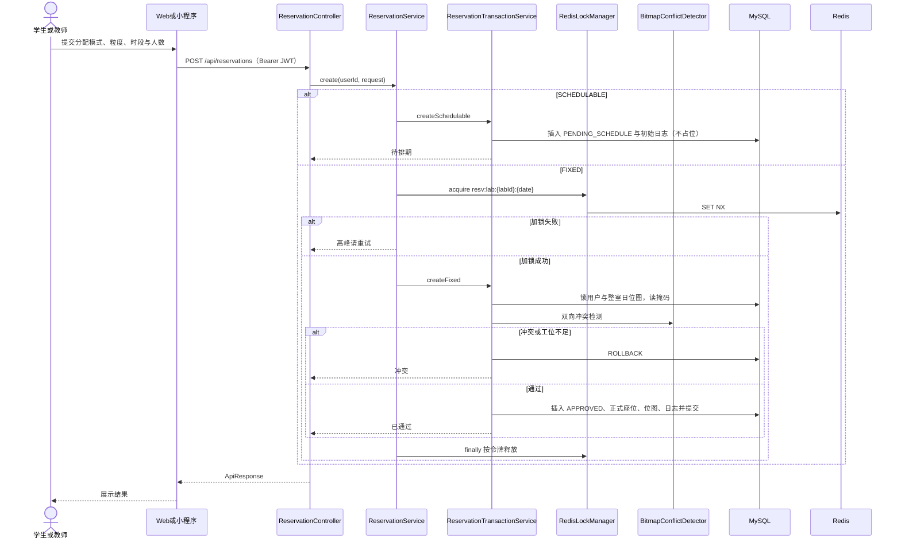
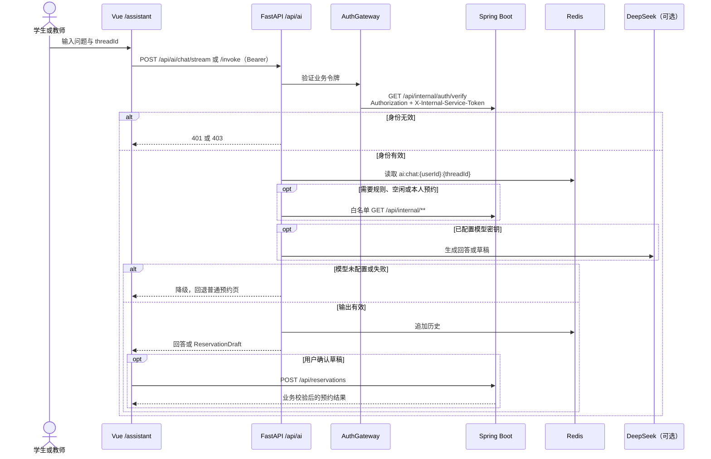
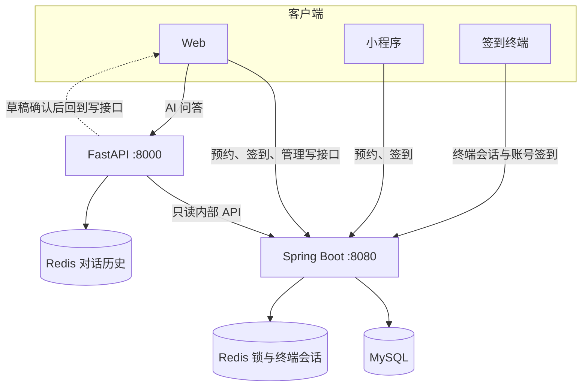

# 架构图 mermaid 源稿（现状）

对照 GitHub main（提交 `2d73a6489babc1ea665feb037c8cdcee16bc1e75`，2026-11-10 23:33 中国标准时间）。已按代码核实。与 `doc/uml/oo-design/10_deployment.current.puml`、`doc/uml/oo-design/05_sequence_reservation.current.puml` 描述同一现状，不含仓库中不存在的 Nginx、独立 `:8081` Worker。不替换原 `10_deployment.puml` 与 `05_sequence_reservation.puml`。本文是 mermaid 源稿，未渲染 png/svg。

---

## 1. 部署视图（当前可运行拓扑）

说明：生产库地址由 `LAB_DB_URL` 注入；上图端口是本地默认值。小程序默认直连 8080，不经过 Vite。图 4-7 主文件仍是目标部署，本图不替代它。

---

## 2. 固定 / 可调度预约时序

---

## 3. 智能助手（开发期，无 Nginx）

说明：小程序目前没有该调用链的页面。已确认：信用、申诉与 AI 当前仅 Web 已有页面，小程序仍为规划；若论文保留「小程序 invoke」，须加此注，不把规划写成已实现页面。

---

## 4. 数据流（写占用与只读助手）

